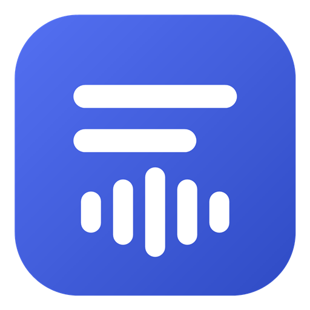
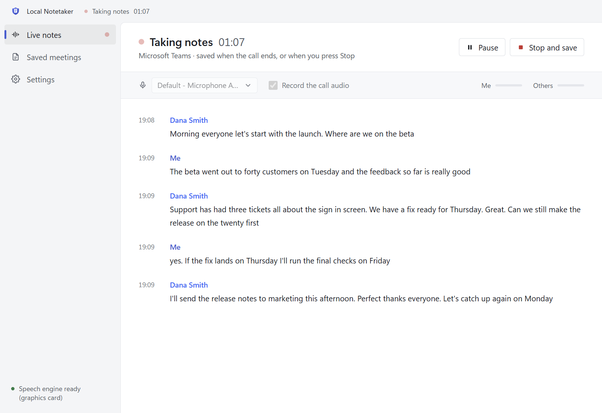

# Local Notetaker

A meeting notetaker for Windows that runs entirely on your PC. It was called Local Transcription in versions 1.3 and 1.4, and Meeting Notetaker before that. When a Microsoft Teams, Google Meet or Zoom meeting starts, it offers to take notes. It transcribes the meeting with NVIDIA Nemotron, tells the voices apart, puts people's names on them from the meeting's live captions, and saves a clear Markdown transcript when the meeting ends.

No audio or text leaves your PC. There's no account and no subscription. See the [privacy policy](PRIVACY.md).

### [Download Local Notetaker for Windows](https://github.com/finn-1o8/meeting-notetaker-downloads/releases/latest)

Windows 10 or 11, 64-bit. The installer is about 1 GB because the speech models are inside it.



## Install

1. Open the [latest release](https://github.com/finn-1o8/meeting-notetaker-downloads/releases/latest) and, under **Assets**, download `Local-Notetaker-Setup-<version>.exe`.
2. Run it. Windows may say "Windows protected your PC", because the installer isn't code-signed yet. Click **More info**, then **Run anyway**.
3. Pick where to install. Your user folder is the default, and no administrator rights are needed. The installer adds Start menu and desktop shortcuts, then opens the app.

If Smart App Control is on, Windows blocks the installer and offers no way to run it. A Microsoft Store version, which Windows allows, is on its way.

If you have Local Transcription or Meeting Notetaker installed, the installer updates it in place, keeping your settings, notes and shortcuts.

To uninstall, go to Windows Settings > Apps > Installed apps. Your meeting notes and settings are kept.

## What it does

- **Notices meetings.** It runs in the system tray and starts with Windows. When a Teams, Zoom or Google Meet call starts, a card in the corner of the screen offers to take notes. It works with the desktop apps, and with all three in a browser. You can also start notes yourself at any time, for an in-person meeting, say.
- **Keeps going until the meeting ends.** It never pauses or stops by itself: not when its window is minimised, not through long silences, and not in meetings of two hours or more.
- **Transcribes both sides.** Your microphone is your side, and what your PC plays is everyone else. Headphones aren't needed: what your speakers play is kept out of your lines.
- **Tells speakers apart and names them.** Voices are numbered Speaker 1, Speaker 2 and so on. With the meeting's live captions on, it reads the names the meeting app shows and puts them on the voices. You can also click a speaker to name them yourself.
- **Saves clear notes.** When the call ends, a card asks whether to save the notes, showing the folder. Click **Save**, or **Change folder…** to save somewhere else. It keeps listening until you answer, in case you're still in the meeting. Each meeting is a Markdown (.md) file named by its date and time; the first suggested folder is `Documents\Meeting Notes`.
- **Pause, resume and look back.** Pause and resume a meeting, and read and search every saved meeting in the app.

## Getting names from captions

Turn on the meeting's live captions and people show up by name instead of "Speaker 1":

| App | How to turn on captions |
| --- | --- |
| Microsoft Teams | More (…) > Language and speech > Turn on live captions |
| Google Meet | Press C, or click **Turn on captions**. Keep the Meet window open; it can be behind other windows. |
| Zoom | Captions (CC) > Show captions |

## A saved meeting

Each meeting is a plain Markdown file, such as `2026-10-23 1400 Microsoft Teams meeting.md`:

```markdown
---
title: Microsoft Teams meeting
date: 2026-10-23
time: 14:00 to 14:42
duration: 42 min
app: Microsoft Teams
participants: "Me, Dana Smith, Speaker 2"
---

# Microsoft Teams meeting

Thursday, 23 October 2026 · 14:00 to 14:42 (42 min)

**People:** Me, Dana Smith, Speaker 2

## Transcript

**14:00 Me:** Thanks for joining. Shall we start with the timeline?

**14:01 Dana Smith:** Sure. The migration is planned for March...
```

The details at the top let note apps such as Obsidian, and Windows search, find meetings by date, app or person.

## Requirements

- Windows 10 or 11, 64-bit.
- About 1.3 GB of disk space.
- Speech runs on an NVIDIA graphics card (RTX 20-series or newer, with a current driver) when there is one. Otherwise it runs on the processor: in testing, two cores of a modern laptop processor kept up with voices told apart. On a slower PC, the others are labelled "Others" so the transcript keeps up.

## Licences

Local Notetaker © 2026 finn-1o8. It includes these components, which keep their own licences:

- **NVIDIA Nemotron Speech Streaming English 0.6B**, the speech recognition model. Licensed by NVIDIA Corporation under the NVIDIA Open Model License.
- **NVIDIA Nemotron 3 Diarization**, the model that tells speakers apart, under the OpenMDW License Agreement 1.1.
- **NVIDIA NeMo-Speech.cpp**, the speech engine, under the Apache License 2.0, with its own third-party notices.
- **Electron and Chromium**, under their licences, which are in the app's folder.

The full texts are in the [licences](licences/) folder here. In the app, they're under Settings > About.
